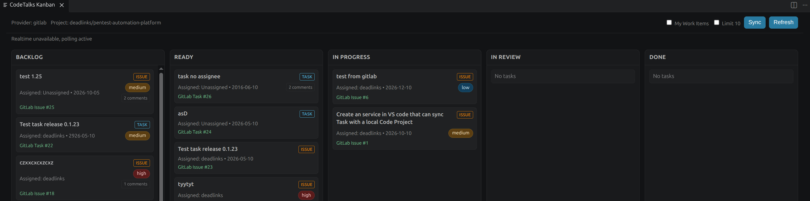

# CodeTalks Features

CodeTalks manages project-scoped **Work Items** in VS Code. Work Item is the generic CodeTalks term; a provider may expose the same record using a provider-specific type.

## Current features

### Work Item board

- Five Kanban statuses: Backlog, Ready, In Progress, In Review, and Done.
- Create and edit Work Items with title, description, developer/assignee, status, priority, tags, and start/due dates.
- Filter and display Work Items in the project associated with the current workspace.
- Show provider type, remote identifier, pending-sync state, and available GitLab discussion counts on board cards.

### Local-first storage

- Keep project configuration and Work Items locally for an offline-first workflow.
- Save Work Items locally when remote creation is unavailable or fails.
- Retry eligible pending Work Items using **CodeTalks: Sync From Remote**.

### Git provider support

- **GitLab:** create and refresh Work Items. New items default to native type **Task**, with **Issue** also selectable. GitLab workflow labels map remote state to the CodeTalks board.
- **GitHub:** create and refresh Issues. Pull requests are excluded from the Work Item list.
- Map supported fields such as descriptions, assignees, labels/tags, priority, and planning dates to provider data. GitLab edits made in CodeTalks are sent to GitLab; GitHub records can be created and refreshed, but extension edits are not currently written back to GitHub.
- Hide remotely closed records from the board; GitLab's `workflow:done` label represents an open item in the Done column.

### Project configuration

- Configure GitLab or GitHub projects through the setup wizard.
- Store multiple project configurations and associate one with the current workspace.
- Keep each Work Item and its sync state scoped to its configured project.

## Current state and development

- CodeTalks does not synchronize comment contents. Comments/activity entered in the extension remain local; GitLab discussion counts may be refreshed and displayed.
- GitHub updates are read from the provider during refresh, but edits made in CodeTalks are currently local-only and can be overwritten by a later refresh.
- The mobile PWA is in an experimental prototype state, not a feature-parity client for the VS Code extension.
- GitHub's remote API calls its records Issues, and the GitLab type selector contains Task and Issue. These are provider-native names; CodeTalks uses **Work Item** as the general product term.
